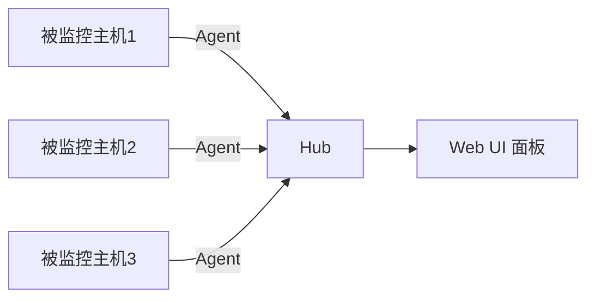

## 前言：为什么我又折腾了一个监控工具

服务器监控这件事，属于那种「平时想不起来，出事就晚了」的存在。

我自己的情况是：VPS 从 3 台变成 8 台，后来又多了台 NUC 做 HomeLab（之前用来当黑苹果的小主机）。某天一台跑着定时任务的虚拟机 OOM 了三天才被发现——因为压根没装监控。于是开始认真搞监控。

谷歌了一圈，展示的一大部份是 Prometheus + Grafana。但实地搞了一遍之后，痛点太真实了（真不是嫌麻烦）：

- **组件太多**：Prometheus、Grafana、node_exporter、cAdvisor……光配置文件就能写一晚上
- **吃资源**：Prometheus 单进程 200-400MB，Grafana 又是 100-200MB，跑在 1C1G 的轻量云服务器上非常吃力
- **学习曲线陡峭**：PromQL 是好东西，但为了看个 CPU 利用率还得写 `rate(node_cpu_seconds_total[5m])`，属实劝退

当然不是说 Prometheus 不好——它是工业级方案，适合 100+ 节点的大规模集群。但对我来说，需求其实很简单：**知道每台机器还活着，CPU/内存/磁盘有没有异常，Docker 容器有没有挂掉**。

于是找到了 Beszel（GitHub真实个好地方😘）。

这东西在 GitHub 上有 **22k stars**，MIT 协议开源，Go 语言写的，v0.18.7，142 位贡献者。最吸引我的是它的哲学：**两个组件，五分钟上线，每台被监控机器只吃不到 10MB 内存**。Reddit 上有人评价它是 "the most elegant self-hosted monitoring tool I've used"（“我用过的最优雅的自托管监控工具”）——用了之后我信了。

这篇文章不是官方文档的翻译，而是我从零部署到稳定运行一个月后的实战总结。

## Beszel 是什么，能做什么

### 架构：简单到只有两个组件

Beszel 采用经典的 Hub-Agent 架构：



- **Hub（中心）**：基于 PocketBase 的 Web 应用，提供仪表板、用户管理、告警配置。默认端口 8090
- **Agent（代理）**：运行在每台被监控主机上，采集指标后发给 Hub。默认端口 45876

两个组件，没有 Redis、没有时序数据库、没有额外的 exporter。这对比 Prometheus 生态让人感动到想哭。

### 能监控什么

| 指标类别 | 具体内容 |
|---------|---------|
| CPU | 主机 + 每个 Docker/Podman 容器 |
| 内存 | 主机 + 容器（含 swap、ZFS ARC） |
| 磁盘 | 使用率 + I/O，支持多分区 |
| 网络 | 主机 + 容器带宽 |
| Docker 容器 | 每个容器的 CPU / 内存 / 网络历史 |
| GPU | Nvidia / AMD / Intel（实验性 NVML 支持） |
| 温度 | 主机传感器（CPU、NVMe 等） |
| 电池 | 主机电池电量（笔记本/ UPS） |
| 系统负载 | Load Average |
| S.M.A.R.T. | 磁盘健康状态（含 eMMC 磨损） |

基本覆盖了个人开发者和中小团队 90% 的监控需求。

### 跟其他方案比呢？

| 维度 | Prometheus + Grafana | Netdata | Beszel |
|------|---------------------|---------|--------|
| 组件数 | 4+ | 1 | 2 |
| 内存占用 | 500MB+ | 200-500MB | <128MB（Hub）+ <10MB（Agent） |
| 部署时间 | 2-8 小时 | 10 分钟 | 5 分钟 |
| Docker 监控 | 需要 cAdvisor | 内置 | 内置 |
| 自定义指标 | 无限制（PromQL） | 丰富 | 固定指标集 |
| 仪表板自定义 | 完全自由 | 高度可定制 | 固定布局 |
| 适用规模 | 100+ 节点 | 中等规模 | 10-100 节点 |
| 协议 | Apache 2.0 | GPL v3 | MIT |

:::tip[一句话选型]
如果你需要自定义指标、PromQL 查询、多数据源仪表板，选 Prometheus + Grafana。如果你只是想知道服务器还活着、资源有没有吃紧、Docker 容器有没有挂——Beszel 是更对的选择。
:::

### 适用与不适用场景

**适合**：
- 个人开发者 / 小团队的 10-100 台服务器
- HomeLab 玩家
- Docker/Podman 环境下的容器监控
- 资源敏感环境（1C1G VPS 也能跑）
- 追求快速搭建、零学习成本的场景

**不适合**：
- 100+ 节点的大规模集群
- 需要自定义指标和复杂查询的场景
- 企业级权限管理和审计需求
- 需要与现有 Prometheus 生态深度集成的场景

## 快速上手：5 分钟跑起来

先说最快的方式——Docker Compose 一键启动。

:::note[前置条件]
本文假设你已经在服务器上装好了 Docker。如果还没装，先去搜「你的系统 + 安装 Docker」搞定，不同发行版步骤不一样，这里不展开。
:::

### 第一步：部署 Hub

```bash
mkdir -p ~/beszel/hub && cd ~/beszel/hub

cat > docker-compose.yml << 'EOF'
services:
  beszel:
    image: henrygd/beszel:latest
    container_name: beszel
    restart: unless-stopped
    environment:
      APP_URL: http://localhost:8090  # 改成你的实际访问地址
    ports:
      - "8090:8090"
    volumes:
      - ./beszel_data:/beszel_data
EOF

docker compose up -d
```

30 秒后，访问 `http://你的IP:8090`，看到注册页面就是成功了。

### 第二步：创建管理员，添加 Agent

1. 访问 Web UI，用邮箱 + 密码创建管理员账户
2. 点击 **"Add System"**，选择 Docker 安装方式
3. 复制生成的 `docker-compose.yml`（里面已经包含了 `KEY` 和 `TOKEN`）

### 第三步：在被监控主机上启动 Agent

```bash
mkdir -p ~/beszel/agent && cd ~/beszel/agent

# 粘贴上一步从 Web UI 复制的 docker-compose.yml
# 内容大概长这样：
cat > docker-compose.yml << 'EOF'
services:
  beszel-agent:
    image: henrygd/beszel-agent:latest
    container_name: beszel-agent
    restart: unless-stopped
    network_mode: host
    volumes:
      - /var/run/docker.sock:/var/run/docker.sock:ro
    environment:
      LISTEN: 45876
      KEY: "ssh-ed25519 AAAA..."
      HUB_URL: "http://你的HubIP:8090"
      TOKEN: "token_value"
EOF

docker compose up -d
```

回到 Web UI，Dashboard 上应该出现一个绿色圆点——恭喜，监控已上线。

:::tip[关键细节]
- `network_mode: host` 是必须的，否则 Agent 拿不到主机的网络统计
- `/var/run/docker.sock` 以只读方式挂载，Agent 就能读到容器指标
- Agent 容器的镜像有普通版、Nvidia 版（`beszel-agent-nvidia`）、Intel 版（`beszel-agent-intel`）——有 GPU 的话选对应版本
:::

## 部署方案细选

上面的 Docker Compose 是最快的方式，但不同场景有不同选择：

| 场景 | 推荐方案 | 理由 |
|------|---------|------|
| 快速体验 / 测试 | Docker Compose | 5 分钟上线 |
| 生产环境 | Docker Compose（Hub 和 Agent 分离） | 易维护、易升级 |
| 无 Docker 环境 | 二进制 + systemd | 零依赖、最小资源 |
| 资源极度受限 | 二进制安装 | 32MB 内存就能跑 Agent |

### 二进制安装

```bash
# Hub
curl -sL https://get.beszel.dev/hub -o /tmp/install-hub.sh
chmod +x /tmp/install-hub.sh
sudo /tmp/install-hub.sh -p 8090 -c "http://your-domain.com"

# Agent
curl -sL https://get.beszel.dev -o /tmp/install-agent.sh
chmod +x /tmp/install-agent.sh
sudo /tmp/install-agent.sh  # 交互式输入 KEY / TOKEN / HUB_URL
```

### systemd 管理 Hub（生产环境推荐）

```bash
sudo tee /etc/systemd/system/beszel.service << 'EOF'
[Unit]
Description=Beszel Hub
After=network.target

[Service]
Type=simple
Restart=always
RestartSec=3
WorkingDirectory=/opt/beszel
ExecStart=/opt/beszel/beszel serve --http "0.0.0.0:8090"
Environment="APP_URL=http://your-domain.com:8090"

[Install]
WantedBy=multi-user.target
EOF

sudo systemctl daemon-reload
sudo systemctl enable --now beszel.service
```

### Agent 通信模式选择

Beszel 支持两种通信方式：

- **SSH 模式**：Hub 主动连接 Agent。适合 Agent 在 NAT 后面、Hub 能访问 Agent 的场景。Agent 监听 45876 端口
- **WebSocket 模式**：Agent 主动连接 Hub。适合 Agent 能访问 Hub 的场景。更简单，不需要 Agent 开端口

Docker Compose 部署默认走 WebSocket 模式——Agent 通过 `HUB_URL` 主动连 Hub，不需要开 45876 端口。如果你的网络拓扑是 Hub 有公网 IP、Agent 在内网，这就是最省事的方案。

## 关键配置与踩坑指南

### 必填环境变量速查

**Hub 端**：

| 参数 | 说明 | 生产建议 |
|------|------|---------|
| `APP_URL` | Hub 访问地址 | **必填**，设错会导致链接和 OAuth 回调异常 |
| `DISABLE_PASSWORD_AUTH` | 禁用密码登录 | 启用 OAuth 后设为 `true` |
| `MFA_OTP` | 双因素认证 | 生产环境建议开启 |
| `SHARE_ALL_SYSTEMS` | 所有用户共享系统 | 通常保持 `false` |

**Agent 端**：

| 参数 | 说明 |
|------|------|
| `KEY` | SSH 公钥，从 Hub Web UI 获取 |
| `TOKEN` | 注册令牌，从 Hub Web UI 获取 |
| `HUB_URL` | Hub 的完整 URL（含协议和端口） |
| `LISTEN` | SSH 监听端口，默认 45876 |
| `NETWORK` | `tcp` / `tcp4` / `tcp6` / `unix` |

:::warning[KEY 和 TOKEN 不要直接写在 compose 文件里提交到 Git]
用 `KEY_FILE` 和 `TOKEN_FILE` 环境变量引用外部文件，配合 Docker Secrets 或文件权限控制（`chmod 600`）。
:::

### 磁盘监控配置

默认情况下 Agent 可能没有监控到你真正关心的磁盘分区：

```bash
# 先确认设备名
lsblk
df -h

# 在 Agent 环境变量中指定
EXTRA_FILESYSTEMS: "sdb,sdc,nvme0n1"
```

### 网络接口过滤

如果你的机器上有 Docker 虚拟网桥（`docker0`、`br-xxx`），带宽统计会包含这些内部流量。建议做过滤：

```bash
# 白名单模式：只监控物理网卡
NICS: "eth0,eth1"

# 黑名单模式：排除虚拟接口
NICS: "-docker*,lo,veth*"
```

### 温度传感器配置

```bash
# 指定面板上显示的主传感器
PRIMARY_SENSOR: "coretemp"

# 白名单：只显示 CPU 温度
SENSORS: "coretemp*"

# 黑名单：排除某些传感器
SENSORS: "-k10temp*"
```

### 反向代理 + HTTPS

如果你有域名，强烈建议用 Nginx 反代，套上 HTTPS。

:::note[前置条件]
Nginx 的安装和 SSL 证书申请（推荐 certbot + Let's Encrypt）不在本文范围，请自行搜索教程搞定后再回来看这里。
:::

```nginx
server {
    listen 443 ssl http2;
    server_name monitor.your-domain.com;

    ssl_certificate     /etc/ssl/certs/monitor.pem;
    ssl_certificate_key /etc/ssl/private/monitor.key;

    location / {
        proxy_pass http://127.0.0.1:8090;
        proxy_set_header Host $host;
        proxy_set_header X-Real-IP $remote_addr;
        proxy_set_header X-Forwarded-For $proxy_add_x_forwarded_for;
        proxy_set_header X-Forwarded-Proto $scheme;

        # WebSocket 支持：这四行是关键
        proxy_http_version 1.1;
        proxy_set_header Upgrade $http_upgrade;
        proxy_set_header Connection "upgrade";
    }
}
```

:::warning[反向代理的两个坑]
1. **WebSocket**：Beszel 仪表板的实时数据走 WebSocket，反代必须配置 `Upgrade` 和 `Connection` 头，否则图表不刷新
2. **APP_URL**：配置了 HTTPS 反代后，Hub 的环境变量 `APP_URL` 必须改成 `https://monitor.your-domain.com`，不然 OAuth 回调地址是错的
3. **Gzip**：如果反代开启了 gzip，要对 `text/event-stream` 类型禁用压缩，否则 SSE 连接可能异常
:::

### OAuth 登录

Beszel 支持 GitHub、Google、GitLab 等 OAuth2 提供商。
配置路径：Settings → Authentication。

建议流程：
1. 先保留密码登录，配置好 OAuth
2. 用新标签页测试 OAuth 登录，确认正常工作
3. 再设置 `DISABLE_PASSWORD_AUTH: "true"` 关闭密码登录

### 敏感信息安全管理

```bash
# 方案一：FILE 环境变量（推荐）
echo "ssh-ed25519 AAAA..." > /etc/beszel/key.pem
chmod 600 /etc/beszel/key.pem

# docker-compose.yml 中引用
environment:
  KEY_FILE: /etc/beszel/key.pem
  TOKEN_FILE: /etc/beszel/token.txt
volumes:
  - /etc/beszel/key.pem:/etc/beszel/key.pem:ro
  - /etc/beszel/token.txt:/etc/beszel/token.txt:ro
```

```bash
# 方案二：Docker Secrets（Swarm 环境）
docker secret create beszel_key ./key.pem
docker secret create beszel_token ./token.txt
```

## 告警与运维：监控的监控

### 告警配置策略

Beszel 内置了告警功能，支持以下指标的阈值配置：

- CPU 使用率
- 内存使用率
- 磁盘使用率
- 网络带宽
- 温度
- 系统负载
- 系统状态（在线/离线）

配置告警时建议遵循分级策略：

| 级别 | 描述 | 示例 |
|------|------|------|
| P0 紧急 | 服务不可用、数据丢失 | 系统离线、磁盘 95%+ |
| P1 重要 | 指标异常，需尽快处理 | 内存 90%+、CPU 持续 95%+ |
| P2 警告 | 资源预警、性能下降 | 磁盘 80%+、负载持续偏高 |

:::tip[告警疲劳是监控的第一大敌]
相同告警 5 分钟内不重复发送。不是每个 CPU 尖峰都值得半夜把你叫起来——关键是趋势和持续性。
:::

### 日常健康检查

把下面这个脚本加到 cron 里，每天跑一次。不熟悉 cron 的话先搜「Linux crontab 教程」了解一下：

```bash
#!/bin/bash
# 每日 Beszel 健康检查
set -e

echo "=== Beszel 健康检查 $(date) ==="

# 1. Hub 状态
if curl -sf http://localhost:8090/api/health > /dev/null; then
    echo "✓ Hub 正常"
else
    echo "✗ Hub 异常！"
fi

# 2. 数据目录大小
echo "数据目录占用:"
du -sh ~/beszel/hub/beszel_data

# 3. 最近错误日志
echo "最近错误（如有）:"
docker compose -f ~/beszel/hub/docker-compose.yml logs --tail 100 2>&1 | grep -i error | tail -5 || echo "  无错误"
```

### 数据备份

Beszel 使用 SQLite 存储数据，备份只需拷贝数据目录：

```bash
# 手动备份
tar -czf beszel_backup_$(date +%Y%m%d).tar.gz \
  ~/beszel/hub/beszel_data \
  ~/beszel/hub/docker-compose.yml

# crontab 自动备份（每天凌晨 2 点，保留 7 天）
0 2 * * * tar -czf /backup/beszel_$(date +\%Y\%m\%d).tar.gz /opt/beszel/beszel_data
0 3 * * * find /backup -name "beszel_*.tar.gz" -mtime +7 -delete
```

Beszel v0.18 也支持自动备份到 S3 兼容存储，可以在 Web UI 中配置。

:::note[容量规划]
每台 Agent 每天大约产生 10-50MB 数据（取决于监控项数量）。计算公式：
`代理数 × 50MB × 保留天数 × 1.2（冗余）`
10 台机器保留 30 天 ≈ 18GB，对 SQLite 来说没有问题。
:::

### 升级流程

```bash
cd ~/beszel/hub

# 1. 备份
cp docker-compose.yml docker-compose.yml.bak
tar -czf beszel_data_backup.tar.gz beszel_data/

# 2. 拉取新镜像并重建
docker compose pull
docker compose up -d

# 3. 验证
curl -sf http://localhost:8090/api/health
docker compose logs --tail 20

# 4. 清理旧镜像
docker image prune -f
```

### 回滚

```bash
# 1. 停服
docker compose down

# 2. 恢复 compose 文件
cp docker-compose.yml.bak docker-compose.yml

# 3. 或直接指定旧版本
# 编辑 compose 文件：image: henrygd/beszel:0.17.3

# 4. 重启
docker compose up -d

# 5. 如果数据也出了问题
rm -rf beszel_data
tar -xzf beszel_data_backup.tar.gz
docker compose up -d
```

:::tip[升级建议]
- 小版本升级（0.18.x → 0.18.y）：通常安全，API 兼容
- 大版本升级：先看 Release Notes，可能有破坏性变更；先在测试环境跑 24 小时
- Agent 和 Hub 建议保持相同主版本，次版本可以不一致
:::

## 常见问题 FAQ

**Q: Agent 连不上 Hub 怎么排查？**

按顺序检查：
1. 网络：从 Agent 主机 `curl http://HubIP:8090/api/health` 能通吗？
2. 防火墙：8090 端口是否开放？
3. 配置：`KEY`、`TOKEN`、`HUB_URL` 三个变量是否全部正确？（`HUB_URL` 要带协议）
4. 时间同步：Agent 和 Hub 的系统时间差太大会导致认证失败，跑一下 `ntpdate pool.ntp.org`

**Q: 系统显示绿色但数据不更新？**

- Agent 进程还活着吗？`docker ps | grep beszel-agent`
- 磁盘满了？`df -h` 看 Agent 的数据目录
- Docker 套接字权限对了吗？`ls -la /var/run/docker.sock`
- 试着重启 Agent：`docker restart beszel-agent`

**Q: 反向代理后图表空白 / 不刷新？**

九成是 WebSocket 没代理对。确认 nginx 配置里这四行：

```nginx
proxy_http_version 1.1;
proxy_set_header Upgrade $http_upgrade;
proxy_set_header Connection "upgrade";
```

还要确认没有对 `text/event-stream` 开启 gzip 压缩。浏览器 F12 → Network 看 WS 连接状态。

**Q: SQLite 撑得住吗？需要换数据库吗？**

对于 Beszel 的使用场景（10-100 台机器），SQLite 完全够用。PocketBase 对 SQLite 做了大量优化（WAL 模式、合理索引）。如果实在担心，做好定期备份即可。目前 Beszel 不支持更换数据库后端，也不需要。

**Q: 能监控非 Docker 的进程吗？**

Beszel 监控的是**主机级别**指标（CPU、内存、磁盘等），不区分 Docker 还是宿主机进程。Docker 容器的**独立统计**是额外功能。你也可以通过 `EXCLUDE_CONTAINERS` 排除某些容器、通过 `EXTRA_FILESYSTEMS` 添加额外磁盘监控。

**Q: 监控中心自己宕机了怎么办？**

这是个经典问题——谁来监控监控系统本身？
- 可以在另一台机器上部署第二个 Beszel 实例，专门监控第一个
- 或者用更轻量的方式：uptime 监控（Uptime Kuma）+ 健康检查脚本
- 至少设置一个「监控离线」告警，这样 Hub 宕机时你还能收到通知

## 总结：监控这件事，简单就是最大的优雅

用了一个月 Beszel 之后，我最大的感受是：**它不会让你觉得「我在做监控」，而是让你觉得「我有监控」**。

不需要写 PromQL、不需要维护 Grafana 面板 JSON、不需要纠结 scrape interval 和 retention policy。打开面板，几台服务器的状态一目了然——绿的放心，红的排查。告警配好之后，平时几乎不用管它，有问题它会主动通知你。

当然它不是银弹。如果需要自定义指标、跨数据源查询、复杂的聚合管道，Prometheus + Grafana 依然是正解。但对于独立开发者、小团队、HomeLab 玩家来说，Beszel 的「够用就好」哲学恰恰是它最大的价值。

GitHub：[henrygd/beszel](https://github.com/henrygd/beszel)  
文档：[beszel.dev](https://beszel.dev/)  
协议：MIT  

:::tip[小广告]
如果你用的是 1C1G 轻量云服务器，跑 Prometheus 太吃力、但确实需要监控——试试 Beszel。五分钟，你会回来感谢我的。
:::
